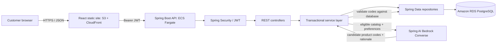
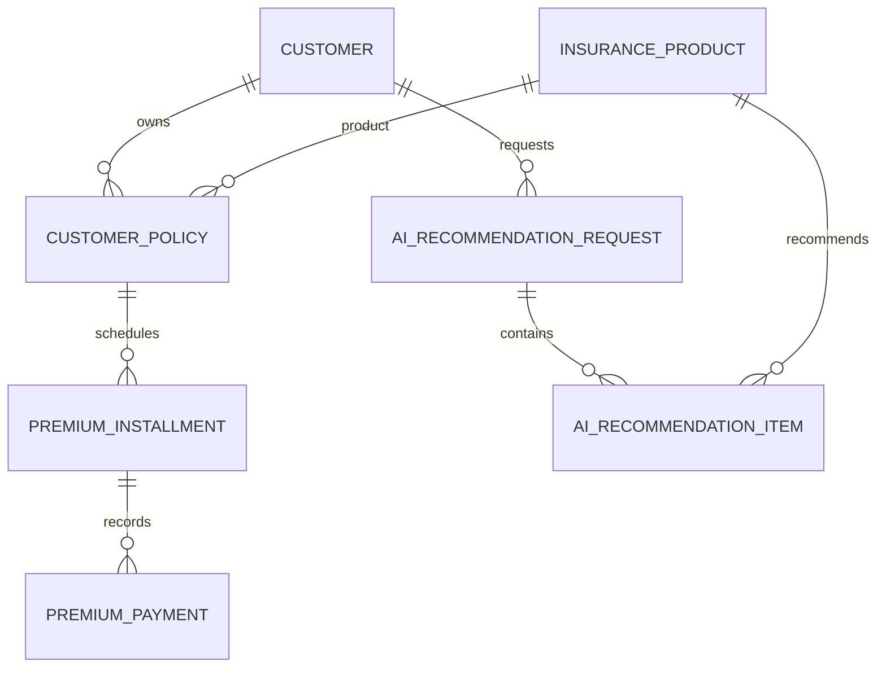

# HealthDekho Project Guide

This guide describes the HealthDekho insurance-management web application, its current implementation, local development workflow, REST API, data model, Bedrock AI flow, security boundaries, and operations. The project follows the supplied capstone's current scope. Claim assessment is intentionally not implemented because the assessment lists it as a future enhancement.

## 1. Product overview

HealthDekho gives an authenticated customer one place to:

- Sign in and view their customer profile.
- View their own insurance policies and premium progress.
- Browse active catalog products they have not already registered.
- Register a product after deterministic age/eligibility checks.
- Generate recommendations with Spring AI and Amazon Bedrock Converse, or use the deterministic fallback when AI is disabled/unavailable.
- Review installment schedules, submit demo payment records, and view transaction history.
- Search their own policies by policy number, customer name, and/or date of birth.

The product catalog is shared. Customer profiles, recommendations, policy records, installments, and payments are customer-scoped. No customer can search another customer's policies through the API.

### Out of scope / important limitations

- Claim intake, AI claim assessment, document handling, and approval workflow are future scope.
- Premium payment is a **simulated record-keeping workflow**. There is no payment gateway, bank transfer, or actual money movement.
- Insurance products and their premiums are sample catalog entries, not a real insurance offer. This app is a capstone/demo, not financial, legal, or insurance advice.
- No self-registration, password reset, MFA, staff/admin portal, or account-management UI is included.
- Spring AI Bedrock calls are optional. Without Bedrock configuration or when the model fails, a deterministic, database-backed ranking is used and recorded.
- AWS resources are not created by these source files. See [AWS deployment runbook](AWS_DEPLOYMENT.md).

## 2. Technology and repository layout

- Java 21, Spring Boot 3.5.7, Spring Web, Spring Security, Spring Data JPA, Bean Validation.
- PostgreSQL, Flyway migrations, Spring AI 1.1.0 Bedrock Converse starter.
- React 19, Vite, Axios, Lucide icons.
- Docker Compose for local PostgreSQL + API + React dev server.

```text
backend/
  src/main/java/com/healthdekho/
    config/         stateless JWT security and CORS
    controller/     REST boundary
    dto/            immutable request/response records
    entity/         JPA entities
    exception/      API errors and exception translation
    repository/     Spring Data persistence queries
    service/        business rules and transactions
  src/main/resources/
    application.yml
    application-local.yml
    db/migration/   production-safe migrations
    db/local/       local-only sample data
  src/test/         unit tests
frontend/
  src/App.jsx       responsive React application and views
  src/api.js        Axios client, bearer token, error handling
  src/styles.css    design system and responsive styling
docs/
  PROJECT_GUIDE.md
  AWS_DEPLOYMENT.md
```

## 3. Architecture and request flow



The frontend never connects directly to PostgreSQL or Bedrock. The API owns validation, financial calculations, identity scoping, and persistence. The model can suggest only identifiers from an eligible product list assembled by the API; returned identifiers are allowlisted against that list before display or save.

### Backend layers

1. **Controller** — HTTP routing, DTO validation, authenticated customer extraction.
2. **Service** — registration eligibility, duplicate rules, schedule creation, payment penalty calculation, recommendation filtering, transaction boundaries.
3. **Repository** — parameterized JPA queries and database row locking for payment processing.
4. **Entity / DTO** — persisted JPA model is not serialized directly; endpoints return Java records.
5. **AI integration** — Spring AI `ChatClient` backed by Bedrock Converse. AI output does not determine premiums, eligibility, or financial totals.

## 4. Data model

All money is stored as PostgreSQL `NUMERIC(19,2)`. Dates use `DATE`; audit times use `TIMESTAMPTZ`. Keys are generated `BIGINT` values. Product master data is separate from customer policy transactions.



| Table | Purpose and important rules |
|---|---|
| `customer` | Login/profile data; unique email; BCrypt password hash; active status; no future DOB. |
| `insurance_product` | Shared catalog, product code, type, term, frequency, premium, cover, entry-age range, active flag. |
| `customer_policy` | Registered policy snapshot and generated policy number; unique `(customer_id, product_id)` prevents duplicate registration. |
| `premium_installment` | Installment number, due date, one-month grace date, scheduled/paid principal, status; unique `(policy_id, installment_number)`. |
| `premium_payment` | Immutable transaction reference/date/amount/penalty/method; unique transaction reference. |
| `ai_recommendation_request` | Customer inputs, computed age, model/prompt metadata and request timestamp. |
| `ai_recommendation_item` | Product-backed ranked recommendation, rationale, suitability, and whether it was registered from the recommendation. |

### Migrations and local-only data

- `V1__initial_schema.sql`: schema, sample products, legacy sample demo rows.
- `V2__remove_demo_customers.sql`: removes embedded demo customer identities and their dependent transactions. It applies in normal (production) profiles.
- `application-local.yml` adds `classpath:db/local` only when the `local` profile is active.
- `V3__seed_local_demo_data.sql`: local-only demonstration customers, sample policies, installments, and payments.

Do not enable the `local` profile in a production environment. Flyway is enabled and Hibernate is set to `ddl-auto: validate`; schema changes belong in new, numbered migrations. Existing migrations are immutable after use in a shared environment.

## 5. Functional behavior and deterministic rules

### Authentication and ownership

- `POST /api/auth/login` verifies the email and password against BCrypt and returns a signed HMAC-SHA256 JWT.
- Token lifetime is 12 hours by default (`TOKEN_HOURS`). Authenticated requests use `Authorization: Bearer <token>`.
- Customer email from the validated JWT is the source of identity. Customer-specific controller inputs cannot select another customer.
- API CORS is restricted to the comma-separated `CORS_ALLOWED_ORIGINS` setting.

### Policy registration

- Product code must identify an active catalog product.
- Customer age is derived from the persisted DOB and selected start date using `Period`/`LocalDate`, then checked against product entry-age bounds.
- The unique customer/product pair is checked in service logic and enforced again by a database unique constraint.
- Maturity date = start date + product term in months.
- Payment count = ceiling(term months / frequency interval months); total scheduled premium = installment premium × count.
- A generated `HDP-<year>-<random suffix>` policy number is stored with a due-date schedule. Each installment's grace date is one month after its due date.

### Premium processing

- The customer selects one or more outstanding installments; each submitted principal amount must be positive and cannot exceed the installment balance.
- The API locks each selected installment in a transaction, preventing concurrent duplicate full payments.
- A 10% penalty is calculated on outstanding principal when payment date is later than the grace-period end. It is recorded separately from principal; the installment balance tracks premium principal.
- Partial principal payments are supported. Status is `PAID`, `PARTIALLY_PAID`, `PENDING`, or `OVERDUE`.
- The service records a transaction reference and payment history. The workflow simulates recording an offline/demo payment; it does not charge a payment method.

### Recommendations with Bedrock

1. Load the authenticated customer's DOB, active products, and current policy set.
2. Compute age in Java and filter out products already registered or outside age eligibility.
3. Send only age, stated preferences, and the remaining product catalog to Bedrock Converse.
4. Ask the model for JSON referencing catalog product codes only.
5. Parse its answer; discard unknown/duplicate codes, cap results, and normalize suitability values.
6. Persist the request/items and return DTOs. A product registered from this recommendation marks the saved item as selected.
7. If AI is disabled, no ChatClient is present, Bedrock is unavailable, or output is invalid, use deterministic matching against stated goals/type and catalog data. The fallback never invents a product.

AI rationale is explanatory text only. It cannot change eligibility, product terms, prices, amounts, or policy state.

## 6. REST API reference

Base path: `/api`. All endpoints except health and login require a valid bearer JWT. Dates are ISO `YYYY-MM-DD`; money values are JSON numbers. Validation errors include `message`, `code`, and `timestamp`.

| Method | Route | Auth | Purpose |
|---|---|---:|---|
| `GET` | `/health` | No | Liveness check; returns `UP`. |
| `POST` | `/auth/login` | No | Authenticate; returns bearer token and customer DTO. |
| `GET` | `/auth/me` | Yes | Return current customer profile. |
| `GET` | `/products` | Yes | List active catalog products. |
| `GET` | `/products/available` | Yes | List products not yet registered by this customer. |
| `GET` | `/policies` | Yes | List current customer's policies. |
| `POST` | `/policies` | Yes | Register a product and generate an installment schedule. |
| `GET` | `/policies/search` | Yes | Search own policies; query: `policyNumber`, `customerName`, `dateOfBirth`, plus `page` and `size` (default 0/25, maximum size 100). At least one search criterion is required. |
| `GET` | `/policies/{policyNumber}` | Yes | Return one owned policy, schedule, and payment history. |
| `GET` | `/policies/{policyNumber}/installments` | Yes | Return the owned policy's schedule. |
| `POST` | `/policies/{policyNumber}/payments` | Yes | Record one or multiple installment payments transactionally. |
| `POST` | `/recommendations` | Yes | Generate and persist a recommendation request/items. |
| `GET` | `/recommendations` | Yes | Return up to 10 most recent requests/items. |

### Example login

```http
POST /api/auth/login
Content-Type: application/json

{"email":"aarav.sharma@example.com","password":"HealthDekho123!"}
```

Example response (token abbreviated):

```json
{"token":"<signed-jwt>","tokenType":"Bearer","expiresInSeconds":43200,"customer":{"id":1001,"email":"aarav.sharma@example.com","fullName":"Aarav Sharma","dateOfBirth":"1990-04-15","phone":"9876501001"}}
```

### Example registration

```http
POST /api/policies
Authorization: Bearer <signed-jwt>
Content-Type: application/json

{"productCode":"HD-SAV-001","startDate":"2026-11-25","recommendationRequestId":null}
```

`recommendationRequestId` is optional; when supplied, the API verifies the recommendation belongs to this customer and contains that product.

### Example recommendations

```http
POST /api/recommendations
Authorization: Bearer <signed-jwt>
Content-Type: application/json

{"goals":"Health cover for my family","preferredTerm":"1 year","preferredPolicyType":"HEALTH"}
```

### Example payment

```http
POST /api/policies/HDP-2026-ABCDEF12/payments
Authorization: Bearer <signed-jwt>
Content-Type: application/json

{"payments":[{"installmentId":4003,"amount":500.00}],"paymentMethod":"UPI"}
```

Supported demo method labels: `UPI`, `CARD`, `NET_BANKING`, `BANK_TRANSFER`. The endpoint records intent; it does not contact a real provider.

## 7. Configuration reference

| Setting | Default / use | Production guidance |
|---|---|---|
| `PORT` | `8080` | Set from the container service if needed. |
| `DATABASE_URL` | Local PostgreSQL JDBC URL | Set to RDS endpoint; use TLS (`sslmode=require`) and private network access. |
| `DATABASE_USERNAME`, `DATABASE_PASSWORD` | Local compose values | Production secret; use unique low-privilege DB user. |
| `JWT_SECRET` | Development-only fallback | Supply a random value of at least 32 bytes from Secrets Manager. Rotate with token invalidation plan. |
| `TOKEN_HOURS` | `12` | Choose an appropriate token lifetime. |
| `CORS_ALLOWED_ORIGINS` | localhost Vite origins | Exact frontend origins, comma-separated, no wildcard for production. |
| `AWS_REGION` | `us-east-1` | Must match an enabled Bedrock model region/endpoint. |
| `BEDROCK_MODEL_ID` | `amazon.nova-lite-v1:0` | Use a model ID enabled and available in the selected region/account. |
| `AI_ENABLED` | `true` outside local; `false` in local profile by default | Enable only after task role/model access and budget are configured. |
| `SPRING_PROFILES_ACTIVE` | default profile | Never use `local` in production. |
| `VITE_API_URL` | `/api` for local proxy | Set at frontend build time to the deployed API base URL, e.g. `https://api.example.com/api`. |

AWS credentials are resolved by the AWS SDK default credential chain. In ECS, grant a task IAM role; **do not** put access keys into environment variables or source code.

## 8. Local development

### One-command Compose workflow

Requirements: Java 21, Maven 3.9+, Node.js 20+, npm, Docker Engine, and Docker Compose v2.

```bash
cp .env.example .env
# Change JWT_SECRET to a random local value before exposing the sandbox.
docker compose up --build
```

- UI: `http://localhost:5173`
- API: `http://localhost:8080/api`
- PostgreSQL: `localhost:5432` (local-only demo credentials from Compose)
- Sample local account: `aarav.sharma@example.com` / `HealthDekho123!`

The local profile includes sample identities/data and AI defaults off. For Bedrock testing on a developer machine, configure AWS CLI credentials/SSO for a permitted IAM identity, then run the API outside Compose with `AWS_PROFILE=<profile> AWS_REGION=<region> BEDROCK_MODEL_ID=<model> AI_ENABLED=true SPRING_PROFILES_ACTIVE=local mvn spring-boot:run` from `backend`. Never commit the AWS profile/credential files.

### Split development

```bash
# Terminal 1: database only
cd <repo-root>
docker compose up db -d

# Terminal 2: API
cd backend
SPRING_PROFILES_ACTIVE=local mvn spring-boot:run

# Terminal 3: React
cd frontend
npm ci
npm run dev
```

### Build and test

```bash
cd backend && mvn test package
cd ../frontend && npm ci && npm run build
```

`PaymentServiceTest` covers partial payment, the grace-period penalty, and paid status. Add service/controller integration tests for any new business rule before production use.

## 9. Security, privacy, and production readiness

- Use HTTPS at CloudFront/ALB and enforce TLS to RDS. Keep RDS private, with inbound PostgreSQL only from the API task security group.
- Keep S3 private and expose the static site through CloudFront Origin Access Control. Never publish `.env`, SQL dumps, credentials, JWTs, or customer exports.
- Store `JWT_SECRET` and DB password in Secrets Manager/SSM references in the ECS task definition. The ECS **task role** gets Bedrock permission; the **execution role** pulls images, writes logs, and resolves task secrets.
- Grant only `bedrock:InvokeModel` on the selected model ARN (and any required inference-profile ARN). Do not grant broad Bedrock administrator permissions. Check regional model availability/access and quotas in the Bedrock console.
- Restrict CORS to the CloudFront/custom-domain origin. Treat the React localStorage bearer token as exposed to successful same-origin script injection; use HTTPS, keep dependencies updated, and consider an HttpOnly-cookie/session design for a real customer-facing system.
- Do not log authorization headers, passwords, prompts containing sensitive data, access tokens, or secrets. Configure CloudWatch retention and alarms.
- Provide a privacy notice/consent appropriate to the real jurisdiction before sending customer-entered goals/preferences and computed age to a model provider. Do not send DOB, email, phone, payment details, or policy identifiers in AI prompts.
- The bundled sample data/accounts are for local demonstration only. Production migration V2 removes these users; verify the deployed DB contains no demonstration identities before opening traffic.
- The application is not a certified insurer/payment processor. Perform security, privacy, financial, and regulatory reviews before any real-world use.

## 10. Troubleshooting

| Symptom | Checks |
|---|---|
| API cannot connect to PostgreSQL | Verify `DATABASE_URL`, credentials, RDS security-group ingress from task SG, subnet routing, and that migrations completed. |
| `FlywayValidateException` | Do not edit a migration already applied. Restore its committed bytes and create a new numbered migration; inspect `flyway_schema_history`. |
| Login returns 401 | Use a local-profile seeded account; confirm local migrations V2/V3 have completed. Production has no seeded accounts. |
| Bedrock credentials/provider error | Verify ECS task role (not execution role), IAM model ARN, `AWS_REGION`, model enablement/availability, quotas, and network path to Bedrock Runtime. |
| Bedrock falls back to catalog ranking | Check `AI_ENABLED=true`, Bedrock model is enabled and correctly identified, and inspect sanitized API logs/CloudWatch errors. Fallback is intentional. |
| Browser CORS failure | Set exact CloudFront/custom UI origin in `CORS_ALLOWED_ORIGINS`, without a trailing route/path, and redeploy the API. |
| Frontend calls wrong API | Rebuild with `VITE_API_URL=https://<api-host>/api`; Vite variables are compiled into static assets. Invalidate CloudFront after upload. |
| Docker migration attempts to run dev seed in production | Remove `SPRING_PROFILES_ACTIVE=local`; only local should load `db/local`. |

## 11. Documentation and references

- AWS deployment runbook: [AWS_DEPLOYMENT.md](AWS_DEPLOYMENT.md)
- Spring AI Bedrock Converse: <https://docs.spring.io/spring-ai/reference/api/chat/bedrock-converse.html>
- Spring AI Bedrock connection properties: <https://docs.spring.io/spring-ai/reference/api/bedrock.html>
- ECS task IAM roles: <https://docs.aws.amazon.com/AmazonECS/latest/developerguide/task-iam-roles.html>
- Amazon Bedrock IAM: <https://docs.aws.amazon.com/bedrock/latest/userguide/security-iam.html>
- AWS App Runner notice (closed to new customers from April 30, 2026): <https://docs.aws.amazon.com/apprunner/latest/dg/what-is-apprunner.html>
